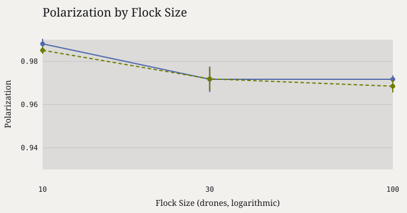
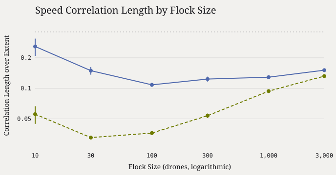
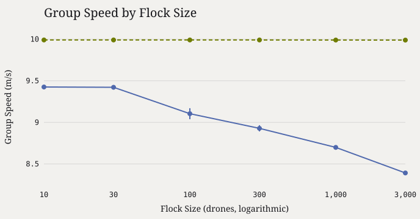
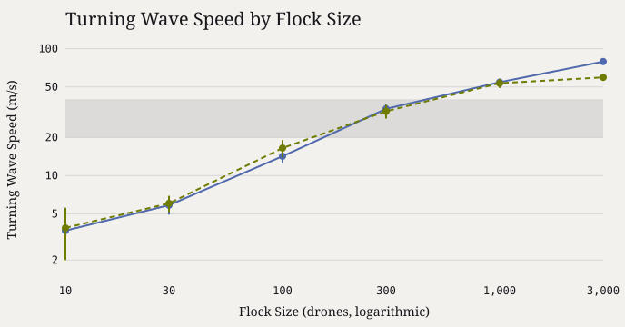
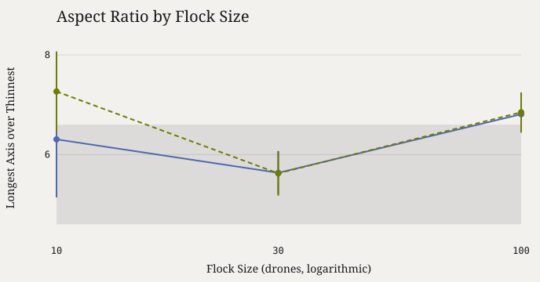
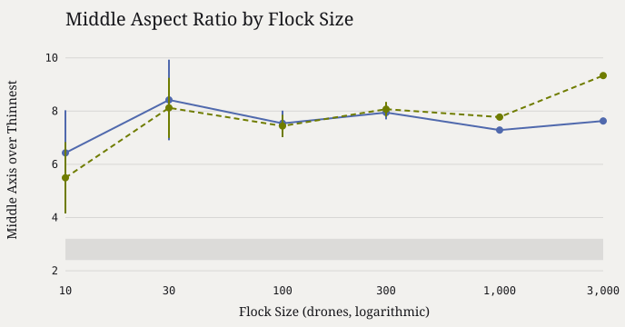
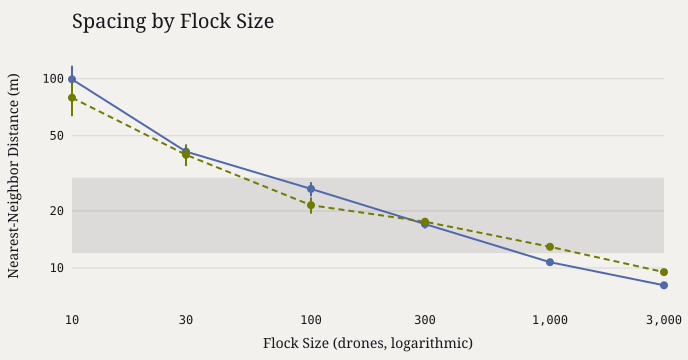
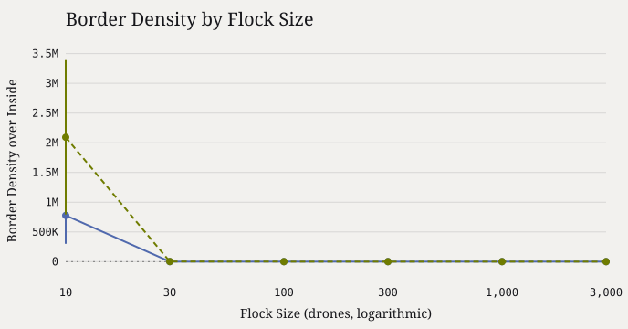
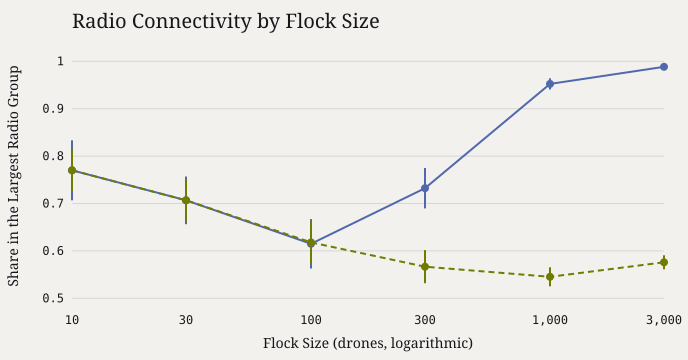

# The Flock in Still Air

*Thermur* sets out to fly a murmuration, so this page flies its flock through air with neither fire nor wind at six sizes from 10 to 3,000 drones and sets each statistic beside what was measured on starling flocks and on an outdoor flock of drones. Every statistic is computed on the flights the pipeline flies, and every norm is declared once in `thermur.metrics` and read from there.

## The Norms

Each norm names the statistic it is set beside, its figure and the spread the study states about it, the flocks it spans, and the study's DOI. Polarization is the length of the mean heading, $`0.96 \pm 0.03`$ across 24 flocks[^cavagna2010]. The speed correlation is the mean over pairs a distance $`r`$ apart of the product of their speed fluctuations about the flock's mean speed, and it first crosses zero at $`0.36\,L`$ across 24 flocks, $`L`$ the largest distance between two birds, so the length over which speeds correlate grows with the flock[^cavagna2010]. Across flocks of 10 to 3,000 starlings the group's mean speed shows no dependence on the number of birds, a Spearman rank correlation of $`-0.13`$[^cavagna2022]. A turn crosses a starling flock at 20 to 40 m/s across 12 flocks[^attanasi2014]. The flock's middle axis over its thinnest measures $`2.8 \pm 0.4`$ and its longest over its thinnest $`5.6 \pm 1.0`$ at 95% confidence across 10 flocks, and the border of a flock is denser than its inside[^ballerini2008b]. An outdoor flock of 30 drones holds its nearest neighbors 12 to 30 m apart[^vasarhelyi2018].

The table is written from `norms.toml`, and `mise render` rewrites it.

<!-- norms -->

| **Statistic** | **Norm** | **Spread** | **Flocks** | **System** | **Source** |
|---|---|---|---|---|---|
| `aspect_ratio` | 5.6 | ±1, 95% confidence interval | 10 | starlings | [10.1016/j.anbehav.2008.02.004](https://doi.org/10.1016/j.anbehav.2008.02.004) |
| `border_density` | above 1 | none stated | 10 | starlings | [10.1016/j.anbehav.2008.02.004](https://doi.org/10.1016/j.anbehav.2008.02.004) |
| `middle_aspect_ratio` | 2.8 | ±0.4, 95% confidence interval | 10 | starlings | [10.1016/j.anbehav.2008.02.004](https://doi.org/10.1016/j.anbehav.2008.02.004) |
| `polarization` | 0.96 | ±0.03, standard deviation | 24 | starlings | [10.1073/pnas.1005766107](https://doi.org/10.1073/pnas.1005766107) |
| `spacing_m` | 21 m | ±9, half range | 1 | drones | [10.1126/scirobotics.aat3536](https://doi.org/10.1126/scirobotics.aat3536) |
| `speed_by_size` | -0.13 | none stated | not stated | starlings | [10.1038/s41467-022-29883-4](https://doi.org/10.1038/s41467-022-29883-4) |
| `speed_correlation_ratio` | 0.36 | none stated | 24 | starlings | [10.1073/pnas.1005766107](https://doi.org/10.1073/pnas.1005766107) |
| `wave_speed_m_s` | 30 m/s | ±10, half range | 12 | starlings | [10.1038/nphys3035](https://doi.org/10.1038/nphys3035) |

<!-- /norms -->

## The Sweep

`Sweep` flies each size with its seeds batched together, first over a short pilot flight and then over a run whose length the pilot sets. A run spans ten of the slower of two relaxation times past its first 20 s, the heading's autocorrelation time and the time over which each drone's seven neighbors rearrange, the alignment and network relaxation times a starling flock shows[^mora2016]. Each time is the integral of its autocorrelation up to the curve's first zero, which leaves the noise past that zero out of the sum. Every size then flies again with each drone held at its cruise speed, which leaves no speed to fluctuate, so its speed correlation is the negative control a measured correlation is read against[^cavagna2010]. The table is written from `Sweep`, and `mise render` rewrites it.

<!-- sweep -->

| **Field** | **Default** | **Bound** | **Holds** |
|---|---|---|---|
| `longest_s` | `600.0` | above 0 | The longest run past the settling a size flies, in seconds, which holds the sweep's wall time and the frames a size keeps in memory bounded |
| `pilot_s` | `120.0` | above 0 | The length of the pilot flight each size's relaxation times are read from, and the shortest run past the settling a size flies, in seconds |
| `pilot_seeds` | `2` | at least 1 | The launches each size's pilot flight flies |
| `seeds` | `10` | at least 1 | The launches each size flies together under `vmap` |
| `sizes` | `[10, 30, 100, 300, 1000, 3000]` |  | The flock sizes, about evenly spaced on a logarithmic axis |
| `spans` | `10.0` | above 0 | The relaxation times a run spans past the settling |

<!-- /sweep -->

Each statistic is measured on the drones' velocities through the air, which still air leaves equal to their velocities over the ground. The speed correlation sums the products of each pair's fluctuations within each of 32 bins across the flock's extent through a weighted `KDTree.count_neighbors`, divides by the pairs in each bin and by the variance of the fluctuations, and reads the zero between the two bins about it, averaged over frames a second apart. The shape reads the axes of the flock's gyration tensor, a stand-in for the axes the source measures from the border of each flock[^ballerini2008b]. The border is that of an α-shape over the flock's `Delaunay` triangulation, keeping each tetrahedron whose circumscribed sphere is narrower than three launch spacings, 45 m, the hop under which two drones fly in one group, and the density at each drone is the inverse cube of its nearest-neighbor distance, the inside counting only drones a kept tetrahedron reaches. The source names no α, so the border, and with it the density ratio, moves with that choice.

The turning wave follows the source's method[^attanasi2014]. Within the frames where the flock's mean heading turns fastest, each pair's delay is the lag maximizing the normalized cross-correlation of their radial accelerations, each drone ranks by how many drones it leads less how many lead it, and its turning time is the mean, over each drone ranked ahead, of that drone's time plus the pair's delay. The distance the turn has crossed is the cube root of the drones turned over the flock's density inside its α-shape, and its speed is the slope of that distance against the turning time over the first half of the ranks. The radio's connectivity is the share of the flock in its largest group, two drones joined wherever they fly within the radio's 50 m range.

## The Run

The figures and the table below come from one run of `thermur fly sweep` under the default composite and plan at sizes of 10, 30, 100, 300, 1,000, and 3,000 drones, ten seeds each, beside the same seeds held at the cruise speed, a full sweep with no size or seed left out. Each size flew a pilot of 120 s over two seeds, and then a run of 410 to 620 s, the first 20 s of it settling, which spans ten of the slower relaxation time the pilot read at every size but 10 drones, whose 79 s rearrangement time the 600 s cap cut to under eight. Each run reads longer times than its pilot, a rearrangement time of 184 s at 10 drones and an autocorrelation time of 54 s at 3,000, so by its own reading a run spans 3.3 to 7.7 of the slower time, and a time near the length of the pilot's 100 s of settled frames is read from too few of them to pin. The sweep took 2 h 11 min on one machine. `mise measure` writes each mean and its standard error across the seeds that measured it out of that run, all ten but for the border density at 10 and 30 drones, 2 and 8, and the turning wave at 10 drones, 9.

Each statistic over its norm, by flock size, sets the flock beside the starlings in one unit, so 1.00 is the norm's own figure and the density ratio, whose norm is any value above 1, stands as measured.

| **Statistic** | **10** | **30** | **100** | **300** | **1,000** | **3,000** |
|---|---|---|---|---|---|---|
| `polarization` | 0.89 | 0.92 | 0.78 | 0.73 | 0.73 | 0.70 |
| `speed_correlation_ratio` | 0.72 | 0.41 | 0.30 | 0.34 | 0.36 | 0.42 |
| `aspect_ratio` | 7.95 | 5.14 | 5.99 | 5.70 | 4.88 | 4.21 |
| `middle_aspect_ratio` | 2.30 | 3.01 | 2.69 | 2.84 | 2.60 | 2.72 |
| `wave_speed_m_s` | 0.12 | 0.20 | 0.47 | 1.12 | 1.81 | 2.64 |
| `spacing_m` | 4.72 | 1.96 | 1.25 | 0.81 | 0.51 | 0.39 |
| `border_density` | 1.06 | 3.87 | 0.92 | 1.07 | 0.23 | 0.17 |

## What the Flock Does

`mise measure` and the site suite's snapshot cases redraw each figure below from the run, the flock in a solid line, its fixed-speed control dashed, each bar a standard error across seeds, and the norm a gray band across its spread or a dotted line where it states none, the vertical axis logarithmic wherever the bars and the norm together span more than a decade.

The flock holds a polarization of 0.86 at 10 drones and falls to 0.67 at 3,000, below the starlings' $`0.96 \pm 0.03`$ at every size. The control falls alike, so holding the speed fixed changes how well the flock aligns by at most 0.06.

The sweep's speed correlation length is drawn from the same run.

The length over which speeds correlate stays a near-constant share of the extent from 100 drones up, 0.11 to 0.15, with a slope against size on logarithmic axes of $`-0.05 \pm 0.02`$ across all six sizes, a length that grows with the flock as a scale-free correlation does, at under half the starlings' $`0.36`$. The control, whose speeds hold only numerical noise about the cruise, reads 0.03 to 0.06 up to 300 drones and climbs to 0.13 at 3,000, so at the largest size the flock's share stands only 0.02 above what the flock's shape alone gives.

The group speed is drawn from the same run.

The flock's mean speed falls from 9.43 m/s at 10 drones to 8.39 m/s at 3,000, a Spearman rank correlation with size of $`-0.94`$ across the sixty flights, where starlings show none, at $`-0.13`$[^cavagna2022]. Its speed is not confined the way a starling flock's is, and the sweep does not measure why.

The turning wave is drawn from the same run.

The crossing speed rises from 4 m/s at 10 drones to 79 m/s at 3,000, a slope of $`0.60 \pm 0.03`$, and passes through the starlings' 20 to 40 m/s near 300 drones. The control reads the same speeds within their errors up to 1,000 drones and 59 m/s at 3,000, so this estimator here reads how the flock's extent grows against the times its drones turn rather than a turn handed from drone to drone through speed, and it says nothing yet on information transfer.

The shape comes from the same run.

The flock is far longer than a starling flock, its longest axis 24 to 45 times its thinnest against the starlings' 5.6, while its middle axis over its thinnest, 6.4 to 8.4, stands near three times the starlings' 2.8. Both read the gyration tensor rather than the border the source measures, which weighs a long tail of drones more heavily.

The spacing and the border come from the same run.

The nearest-neighbor distance falls from 99 m at 10 drones to 8 m at 3,000, inside the outdoor drone flock's 12 to 30 m at 100 and 300 drones. At 10 and 30 drones the drones sit 99 m and 41 m apart against the α-shape's 45 m, so its tetrahedra hold few drones, and only 2 and 8 of the ten seeds hold a drone inside the shape at each of the last ten frames, over which the border reads $`1.06 \pm 0.59`$ and $`3.87 \pm 1.93`$ times as dense as the inside, a reading of the α rather than of the flock. At 100 and 300 drones it reads $`0.92 \pm 0.21`$ and $`1.07 \pm 0.40`$, within a standard error of an even density rather than the denser border of a starling flock, and 0.23 and 0.17 at 1,000 and 3,000, where the core is denser than the border.

The radio's connectivity comes from the same run.

The largest radio group holds 0.62 to 0.77 of the flock up to 300 drones and 0.95 and 0.99 at 1,000 and 3,000, where the spacing falls well inside the radio's range. The control's falls to 0.55 to 0.58 from 300 drones up, so the speed slot is what keeps a large flock in one radio group.

## Whether the Flock Sits Near a Critical Point

The starling studies read a correlation length growing with the flock and a speed held in a narrow band as a sign that the flock is poised near a critical point, where a small push reaches every bird[^cavagna2010][^bialek2014][^cavagna2022]. The sweep supports the first half only in part: from 100 drones up the length grows with the extent as a scale-free length does, but at under half the starlings' share, and the control's own share climbs to meet it at 3,000. It contradicts the second half, since the group speed falls with size where a starling flock's holds. So the sweep does not show the flock near a critical point, and the polarization below the starlings' at every size points to a flock less ordered than a starling flock.

## What the Sweep Cannot Show

- It flies one composite at its default settings, so it cannot say whether another setting of any slot brings the flock nearer a critical point, which only a sweep across the slots' settings would show
- It measures no susceptibility or response to a push, the direct test of a critical point the starling studies infer from correlations
- Its turns are the flock's own, with no predator or threat, so they are not the startled turns the wave speed norm measures, and the control shows the estimator cannot yet tell the two apart
- Its sizes stop at 3,000 drones and its seeds at ten, so a trend past 3,000 or a spread across launches wider than ten seeds show is outside what it measured
- Its shape reads the gyration tensor's axes in place of the border's, and its border an α at three launch spacings, so both ratios move with those choices

[^cavagna2010]: Cavagna et al. 2010. "Scale-free correlations in starling flocks." *Proceedings of the National Academy of Sciences* 107(26): 11865–11870. <https://doi.org/10.1073/pnas.1005766107>

[^cavagna2022]: Cavagna et al. 2022. "Marginal speed confinement resolves the conflict between correlation and control in collective behaviour." *Nature Communications* 13(1): 2315. <https://doi.org/10.1038/s41467-022-29883-4>

[^attanasi2014]: Attanasi et al. 2014. "Information transfer and behavioural inertia in starling flocks." *Nature Physics* 10(9): 691–696. <https://doi.org/10.1038/nphys3035>

[^ballerini2008b]: Ballerini et al. 2008. "Empirical investigation of starling flocks: a benchmark study in collective animal behaviour." *Animal Behaviour* 76(1): 201–215. <https://doi.org/10.1016/j.anbehav.2008.02.004>

[^vasarhelyi2018]: Vásárhelyi et al. 2018. "Optimized flocking of autonomous drones in confined environments." *Science Robotics* 3(20): eaat3536. <https://doi.org/10.1126/scirobotics.aat3536>

[^mora2016]: Mora et al. 2016. "Local equilibrium in bird flocks." *Nature Physics* 12(12): 1153–1157. <https://doi.org/10.1038/nphys3846>

[^bialek2014]: Bialek et al. 2014. "Social interactions dominate speed control in poising natural flocks near criticality." *Proceedings of the National Academy of Sciences* 111(20): 7212–7217. <https://doi.org/10.1073/pnas.1324045111>
